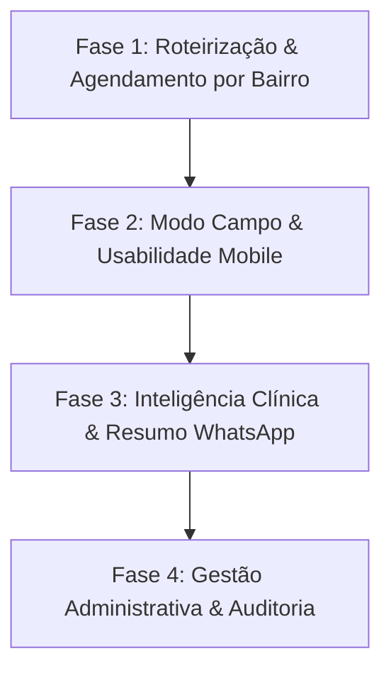

# Plano de Implementação · Atendimento Clínico Cuida Amor 🩺❤️

> **Versão:** 1.0  
> **Status:** Implementado — build e TypeScript do subprojeto aprovados  
> **Aplicação:** `atendimento-clinico/`  
> **Integração:** Backend SoftCare / SQL Server  

---

## 1. Visão Geral e Objetivo
Transformar o subprojeto **Atendimento Clínico** na ferramenta de campo definitiva para a equipe de enfermagem da **Cuida Amor**, combinando:
1. **Agilidade em Campo (Mobile/Tablet):** Roteirização rápida por bairro, integração com GPS (Waze/Google Maps), consulta histórica em 1 clique e formulários intuitivos.
2. **Cuidado Humanizado:** Alertas visuais automáticos de sinais vitais e geração de resumo amigável para envio à família via WhatsApp.
3. **Controle e Governança:** Painel gerencial de aderência de visitas, auditoria e consolidação das 4 notas de satisfação do contratante.

---

## 2. Diagnóstico: Protótipo HTML vs. Sistema Atual

| Funcionalidade | Protótipo HTML | App Atual (`atendimento-clinico/`) | Meta de Excelência (Este Plano) |
| :--- | :--- | :--- | :--- |
| **Identidade Visual** | Cuida e Amor | Cuida Amor (Atualizado) | Paleta harmoniosa, logotipo oficial e modo claro/escuro impecáveis |
| **Banco de Dados** | `localStorage` estático | SQL Server via SoftCare API | Dados reais, sincronizados e persistentes |
| **Roteiro por Bairro** | ✅ Agrupamento por bairro | ❌ Busca individual | **Agrupamento por bairro e agendamento em lote** |
| **Acesso a GPS** | ❌ Não possui | ❌ Não possui | **Botão 1-toque para Google Maps e Waze** |
| **Consulta Histórica** | ✅ Banner no topo do form | Aba separada | **Gaveta/modal para espiar a última visita durante o preenchimento** |
| **Alertas Clínicos** | ❌ Apenas inputs simples | Inputs validados | **Destaque visual em sinais vitais críticos (PA, SpO2, HGT)** |
| **Resumo Familiar** | ❌ Não possui | ❌ Não possui | **Gerador de mensagem formatada para WhatsApp do contratante** |
| **Satisfação** | 4 notas em estrelas | 4 notas em estrelas + NPS | 4 estrelas Cuida Amor + feedback consolidado |

---

## 3. Roteiro de Implementação por Fases



---

### 🗺️ FASE 1: Roteirização e Agendamento Inteligente por Bairro
> **Meta:** Otimizar o tempo e o deslocamento das enfermeiras de campo através de rotas geográficas claras.

- [x] **1.1. Extração e Indexação por Bairro**
  - Mapear os bairros dos pacientes com escala ativa e padronizar cores/badges visuais (ex.: *Pituba*, *Barra*, *Graça*, *Ondina*, *Federação*).
- [x] **1.2. Modal de Agendamento Agrupado por Região**
  - Ao abrir o agendamento em uma data, exibir os pacientes organizados por bairro em formato colapsável/cards.
  - Opção de marcar múltiplas visitas para o mesmo bairro com horários sequenciais sugeridos (ex.: 09:00, 10:30).
- [x] **1.3. Filtro de Bairro na Agenda Diária e Mensal**
  - Botões de filtro rápido no topo da agenda para visualizar apenas visitas de determinada região.

---

### 📍 FASE 2: Modo Campo & Usabilidade Mobile da Enfermeira
> **Meta:** Tornar o dia a dia da enfermeira fluido, rápido e livre de atritos no smartphone.

- [x] **2.1. Atalho de GPS (Google Maps & Waze)**
  - No card da visita e na ficha do paciente, incluir botão que abre diretamente o endereço no aplicativo de navegação instalado:
    - `https://www.google.com/maps/search/?api=1&query={endereco}+{bairro}`
    - `https://waze.com/ul?q={endereco}+{bairro}`
- [x] **2.2. Card Destacado da "Próxima Visita"**
  - No topo da tela inicial de trabalho, destacar a próxima visita do dia com tempo estimado, status atual e botão de início rápido em 1 toque.
- [x] **2.3. Gaveta Lateral / Consulta Rápida da Última Visita no Formulário**
  - Dentro do formulário de evolução, adicionar botão fixo/gaveta *"Ver Última Evolução"*.
  - A enfermeira pode conferir PA de base, curativo anterior e conduta sem fechar ou perder o preenchimento atual.

---

### 🩺 FASE 3: Inteligência Clínica & Resumo para WhatsApp
> **Meta:** Garantir rigor clínico e transparência direta para a família contratante.

- [x] **3.1. Alertas Visuais de Sinais Vitais**
  - Sinalização colorida em tempo real ao digitar:
    - PA Sistólica $\ge 140$ ou $\le 90$ mmHg (Alerta Âmbar/Vermelho)
    - $\text{SpO}_2 < 95\%$ (Alerta Âmbar) ou $< 92\%$ (Alerta Vermelho)
    - Glicemia/HGT fora do padrão ($\le 70$ ou $\ge 180$ mg/dL)
- [x] **3.2. Gerador de Resumo para WhatsApp da Família**
  - Ao concluir a visita, exibir botão *"Copiar Resumo da Visita"* ou *"Enviar no WhatsApp"*.
  - Modelo de mensagem pré-formatado, humanizado e profissional:
    ```text
    Olá, [Nome do Contratante]! 🌸
    A enfermeira [Nome] concluiu a visita de hoje de [Nome do Idoso]:
    
    🩺 Sinais Vitais: PA 120x80 mmHg, SpO2 97%, FC 74 bpm.
    📋 Avaliação: Paciente lúcido(a), bem hidratado(a) e estável.
    🩹 Cuidados: Curativo renovado sem intercorrências.
    
    Atenciosamente,
    Equipe Cuida Amor · Excelência no Cuidado ❤️
    ```
- [x] **3.3. Formulário de Satisfação Cuida Amor**
  - Garantir o registro das 4 estrelas com feedback direto:
    1. Monitoramento & Comunicação
    2. Suporte da Enfermagem
    3. Equipe de Cuidadores (Dia)
    4. Equipe de Cuidadores (Noite)

---

### 📊 FASE 4: Gestão Administrativa, Relatórios & Auditoria
> **Meta:** Dar à liderança clínica visibilidade total da qualidade e frequência assistencial.

- [x] **4.1. Painel de Aderência e Visitas Realizadas**
  - Indicador mensal de metas de visitas cumpridas por enfermeira e por escala.
- [x] **4.2. Relatório de Satisfação Consolidado Cuida Amor**
  - Média ponderada das avaliações dos clientes, com alertas para notas $\le 3$ estrelas para intervenção preventiva imediata.
- [x] **4.3. Exportação e Ficha de Impressão A4**
  - Geração de relatório para conferência médica e do contratante em formato PDF padrão institucional.

---

## 4. Checklist de Execução Imediata

| Item | Ação | Complexidade | Prioridade |
| :---: | :--- | :---: | :---: |
| **1** | Adicionar atalho GPS (Google Maps / Waze) nos cards de visita | Baixa | ⚡ Imediata |
| **2** | Implementar gaveta "Ver Última Visita" no formulário de evolução | Baixa | ⚡ Imediata |
| **3** | Adicionar gerador de resumo de visita para WhatsApp | Média | ⚡ Imediata |
| **4** | Criar modal de agendamento agrupado por Bairro | Média | 🚀 Alta |
| **5** | Adicionar alertas visuais automáticos nos sinais vitais | Baixa | 🚀 Alta |
| **6** | Integrar métricas de satisfação consolidadas nos relatórios | Média | Média |

## 5. Registro de Implementação e Validação

- Agenda: filtros de bairro afetam a lista diária e o calendário mensal; o formulário agrupa idosos por bairro, sugere horários espaçados por 90 minutos e valida em lote que a região, data, elegibilidade da enfermeira e escala ativa sejam válidas antes de gravar.
- Modo campo: cards de visita e ficha do idoso oferecem rotas para Google Maps e Waze. A próxima visita de hoje exibe o tempo restante e permite confirmar, iniciar ou abrir o atendimento conforme seu estado.
- Evolução: a última evolução abre em uma gaveta durante o preenchimento; os campos atuais permanecem no formulário. Alertas orientam a conferência das medidas e os protocolos existentes, sem diagnóstico automático.
- Resumo familiar: após salvar a evolução vinculada à visita, o profissional pode revisar e copiar o resumo ou abrir o WhatsApp para escolher o destinatário. O comentário de satisfação não é incluído nessa mensagem.
- Satisfação: quatro novas categorias são salvas separadamente. As quatro notas históricas continuam identificadas como formulário anterior e não são renomeadas. Relatórios mostram médias, respostas, tendência mensal, alertas de nota até 3 e aderência por enfermeira/escala; a impressão usa folha A4 em paisagem.
- Dados: as colunas novas são adicionadas de forma idempotente pelo backend ao inicializar a integração. Não foi necessário criar dados operacionais fictícios.
- Validação executada: `npx tsc --noEmit --incremental false` no subprojeto e `npm run build` em cópia isolada. A tipagem total do sistema principal continua apontando erros preexistentes em arquivos `scratch`, testes antigos e `src/app/api/relatorios/route.ts`; nenhum desses erros aponta para os arquivos do atendimento clínico alterados.
- Revisão visual autenticada não executada: foi mantida a decisão anterior de parar na validação técnica, e não há credenciais de teste disponíveis nesta sessão.